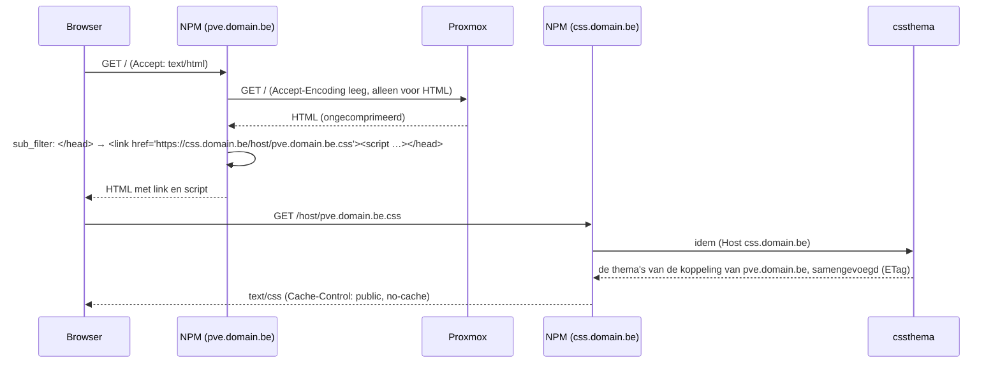

# 10 — Theme-injectie per applicatie

> Status: **goedgekeurd** · Versie 0.3 · 2026-10-17 (§ 2: één regel met `$host` voor alle hosts)
> ✓ Het NPM-mechanisme is gevalideerd in [spike S1](spikes/s1-npm-injectie.md) (NPM 2.16.0, lokaal). Per app volgt nog een test in de eigen omgeving. App-specifieke opties zijn gebaseerd op de huidige kennis van die apps en worden per app gemarkeerd met "laatst geverifieerd op versie X" in `docs/apps/` zodra dat getest is.

## 1. Methodes in één oogopslag

| Methode | Hoe | Werkt voor | Voordelen | Nadelen |
|---|---|---|---|---|
| **A. Reverse proxy (NPM `sub_filter`)** — *standaard* | NPM voegt `<link>` in elke HTML-response in | Alle gebruikers en apparaten, ook mobiel | Centraal, geen client-installatie | Alleen light DOM; vereist `Accept-Encoding`-truc; kan bij app-updates breken |
| **B. Native app-optie** | App heeft zelf een custom-CSS-veld of -mechanisme | Jellyfin, Nextcloud (app), Home Assistant (themes), Authentik, Uptime Kuma (statuspagina's) | Officieel ondersteund, overleeft updates | Niet elke app heeft het; soms beperkt tot variabelen |
| **C. Browserextensie (Stylus)** | UserCSS met automatische updates vanaf cssthema | Alleen jouw browser(s) | Geen serverwijziging, per gebruiker aan/uit | Per apparaat installeren; niet op mobiel (behalve Firefox Android) |
| **D. Userscript (Violentmonkey/Tampermonkey)** | Script haalt CSS op en injecteert in document **én open shadow roots** | Alleen jouw browser(s) | Enige client-methode die Shadow DOM bereikt | Per apparaat; scriptmanager nodig |
| **E. Eigen extensie** (v1.2) | Extensie leest `injection-map.json` en injecteert per hostname | Alle apps in één keer | Eén installatie voor alles | Nog te bouwen |

**Aanbevolen volgorde per app:** B als de app het netjes ondersteunt → anders A → C/D als persoonlijke aanvulling of voor Shadow DOM.

## 2. Methode A — Nginx Proxy Manager (`sub_filter`, één regel voor alle hosts)

### 2.1 Principe



Elke proxy host krijgt **dezelfde** regel, met `$host` in de URL. Welke thema's en scripts een host krijgt, kies je in cssthema op de pagina **Hosts**; de koppeling `*` geldt voor elke host zonder eigen koppeling. Zo verander je een thema of de bestanden van een host alleen nog in het dashboard, nooit meer in NPM, en kan een script (`scripts/npm/regel.py`) de regel in alle ± 100 hosts zetten.

De bestanden komen standaard van het publieke CSS-domein (`PUBLIC_BASE_URL`, een proxy host zonder login die naar cssthema wijst). De meeste apps hebben geen CSP die dat tegenhoudt, en elke host deelt zo dezelfde cachebare URL. Apps met een strenge CSP (`style-src 'self'`, zoals Nextcloud of Vaultwarden) krijgen dezelfde regel via `/alg-thema/` op hun eigen domein (§ 2.3). Valt cssthema uit, dan faalt alleen die stylesheet; de app werkt gewoon, en nginx van cssthema levert intussen de laatste versie uit zijn cache.

### 2.2 De regel

NPM → *Hosts* → *Proxy Hosts* → host bewerken → tab *Advanced* → *Custom Nginx Configuration* (de pagina Hosts toont hem met jouw `PUBLIC_BASE_URL`):

```nginx
# cssthema: zelfde regel in elke proxy host
sub_filter '</head>' '<link rel="stylesheet" href="https://css.domain.be/host/$host.css"><script src="https://css.domain.be/host/$host.js" defer></script></head>';
sub_filter_once on;
set $ct_ae $http_accept_encoding;
if ($http_accept ~* "text/html") { set $ct_ae ""; }
more_set_input_headers "Accept-Encoding: $ct_ae";
# /cssthema
```

- `sub_filter` werkt alleen op ongecomprimeerde HTML. De drie regels met `$ct_ae` halen `Accept-Encoding` weg bij paginaverzoeken (de browser vraagt `text/html`); scripts, CSS en JSON van de app blijven gecomprimeerd.
- Waarom `more_set_input_headers` en niet `proxy_set_header Accept-Encoding ""`: de regel staat op serverniveau, en de `location /` van NPM zet zijn eigen `proxy_set_header`-regels (`include conf.d/include/proxy.conf`). Dan erft die location geen enkele `proxy_set_header` van de server meer, en stuurt de app gzip. `more_set_input_headers` (headers-more, zit in de OpenResty van NPM) wordt wel geërfd.
- De regel heeft geen `location /`. NPM laat zijn eigen `location /` alleen weg als *Advanced* er een bevat; zo blijven de Access List, de websockets en *Block Common Exploits* van die host gewoon werken.
- `# cssthema…` en `# /cssthema` markeren het blok, zodat een script het idempotent kan vinden en vervangen.
- Nooit in het dashboard (`DASHBOARD_HOST`), het CSS-domein, Authentik of de beheerpagina van NPM; cssthema geeft daar ook zelf een lege bundel (`DASHBOARD_HOST`, host van `PUBLIC_BASE_URL`, `EXCLUDED_HOSTS`). Zie docs/ops/installatie-debian.md § 4, *Nooit de regel*.

**Getest op NPM 2.16 (2026-10-17):** injectie werkt bij een app die zijn HTML gzipt; scriptverzoeken van de app komen nog met `Accept-Encoding: gzip` aan; de host blijft *Online*. Spike S1 (2026-10-05) testte de eerdere vorm met een eigen `location /` en `proxy_set_header Accept-Encoding ""`: die werkt alleen zolang de `location /` in *Advanced* staat, en dan vallen de Access List en de andere instellingen van de `location /` van NPM weg.

### 2.3 Strenge CSP: via het eigen domein van de app

Laadt een app geen CSS van een ander domein, dan haalt NPM de bundel via `/alg-thema/` op het domein van de app zelf. Standaard **alleen CSS**, zodat bijvoorbeeld een wachtwoordkluis nooit JavaScript van cssthema krijgt:

```nginx
# cssthema: zelfde regel in elke proxy host (eigen domein, alleen CSS)
sub_filter '</head>' '<link rel="stylesheet" href="/alg-thema/host/$host.css"></head>';
sub_filter_once on;
set $ct_ae $http_accept_encoding;
if ($http_accept ~* "text/html") { set $ct_ae ""; }
more_set_input_headers "Accept-Encoding: $ct_ae";
location ^~ /alg-thema/ {
    limit_except GET HEAD { deny all; }
    proxy_set_header Cookie "";
    proxy_set_header Authorization "";
    proxy_connect_timeout 2s;
    proxy_read_timeout 5s;
    proxy_ssl_server_name on;
    proxy_pass https://css.domain.be/;
}
# /cssthema
```

- `limit_except` laat alleen lezen door; `Cookie` en `Authorization` leeg: de sessie van de app gaat nooit naar cssthema. Via `/alg-thema/` komt het verzoek met `Host: css.domain.be` bij cssthema aan, dus `/alg-thema/api/…` geeft daar `404`.
- Korte timeouts: een stylesheet houdt het tonen van de pagina tegen.
- De `302` van een host zonder eigen koppeling is relatief (`*.css`) en blijft dus onder `/alg-thema/host/`.

Voor apps die alleen scripts van een ander domein blokkeren (Portainer, qBittorrent, Pi-hole) bestaat een variant **met script**, apart en met een waarschuwing: dat script draait op het domein van de app zelf, met alles wat de gebruiker daar kan. Dezelfde regel, met als commentaar `(eigen domein, CSS en script)` en deze vervanging:

```nginx
sub_filter '</head>' '<link rel="stylesheet" href="/alg-thema/host/$host.css"><script src="/alg-thema/host/$host.js" defer></script></head>';
```

Nooit voor een wachtwoordkluis (Vaultwarden), Authentik of NPM zelf. De volledige tekst van beide varianten staat in docs/ops/installatie-debian.md § 4.

Nog per app te controleren: apps die `</head>` anders schrijven (dan `sub_filter '<head>' '<head><link …>'`), plus *Force SSL*.

### 2.4 Afwijkingen per app

| App | Bijzonderheid |
|---|---|
| Proxmox VE | `pveproxy` comprimeert → de `Accept-Encoding`-regels uit § 2.2 zijn nodig. noVNC/xterm-console gaat via websockets (*Websockets Support* van de proxy host). ExtJS rendert alles client-side; classes `.x-*`. |
| Grafana | Werkt met de regel. Gebruik bij voorkeur de door Grafana gezette CSS-variabelen en `data-testid`-attributen; Emotion-classnamen (`css-xxxx`) zijn niet stabiel. |
| UniFi Network | Veel realtime via websockets; de regel volstaat (*Websockets Support* aan). Self-signed upstream → `proxy_ssl_verify off` (NPM-scheme `https`). |
| Immich | SvelteKit; gehashte `svelte-xxxx`-classes vermijden, richten op Tailwind-utility-classes en structuur. Upload-endpoints niet raken (sub_filter raakt alleen HTML). |
| Portainer | Angular/React mix; blokkeert scripts van een ander domein → eigen-domeinvariant met script (§ 2.3). |
| Uptime Kuma | Dashboard via de regel; statuspagina's hebben een native custom-CSS-veld (methode B). Socket.io → *Websockets Support*. |
| Nextcloud | Werkt, maar methode B heeft de voorkeur (zie § 3.2). |
| Home Assistant / Authentik | Werkt technisch, maar bereikt door Shadow DOM weinig → zie § 3. |

## 3. Per applicatie

### 3.1 Proxmox VE
- **Aanbevolen:** A (NPM `sub_filter`).
- **Native:** geen custom-CSS-optie. Het aanpassen van `/usr/share/pve-manager/index.html.tpl` op de host werkt maar wordt bij elke `pve-manager`-update overschreven → afgeraden (alleen als noodoptie gedocumenteerd).
- **Persoonlijk:** C (Stylus) of D.
- Let op: thema niet laten gelden voor de console-iframe tenzij gewenst; de console heeft eigen HTML.

### 3.2 Nextcloud
- **Aanbevolen:** B — app **"Custom CSS"** (`theming_customcss`) uit de Nextcloud App Store. In *Instellingen → Beheer → Theming → Custom CSS*:
  ```css
  @import url("/alg-thema/nextcloud.css");
  ```
  Met de `location ^~ /alg-thema/` uit § 2.3 in de proxy host van Nextcloud valt dit binnen de CSP van Nextcloud. Een `@import` naar `https://css.domain.be/…` wordt door de CSP geblokkeerd.
- **Alternatief:** A volledig.
- Nextcloud biedt veel CSS-variabelen (`--color-main-background`, `--color-primary-element`, …): de generator en AI richten zich daar eerst op, dat is het meest update-bestendig.

### 3.3 Immich
- **Aanbevolen:** A.
- **Native:** geen custom-CSS-instelling bekend (te verifiëren per versie).
- **Persoonlijk:** C/D. Mobiele Immich-app is native (Flutter) → CSS-thema's gelden alleen voor de webinterface.

### 3.4 Grafana
- **Aanbevolen:** A.
- **Native:** geen custom CSS; wel ingebouwde light/dark-thema's. Een eigen thema bovenop "dark" geeft het minste werk.
- **Alternatief op serverniveau:** `public/` overschrijven in de container — afgeraden (verdwijnt bij update).

### 3.5 Home Assistant
- **Aanbevolen:** B — **HA-thema's** (de officiële manier, werkt in Shadow DOM omdat het CSS-variabelen zijn):
  ```yaml
  # configuration.yaml
  frontend:
    themes: !include_dir_merge_named themes
  ```
  Download `https://css.domain.be/themes/home-assistant.ha.yaml` naar `config/themes/cssthema.yaml` (cssthema genereert dit uit het palet en de variabelen van het thema; F-CD-09), herlaad thema's, kies het thema in het profiel.
- **Dieper (per kaart):** de community-integratie `card-mod` (HACS) met card-mod-thema's.
- **Volledige CSS incl. shadow roots:** `frontend: extra_module_url:` met een door cssthema gegenereerde JS-module (variant van de userscript-export, v0.7) die de stylesheet in open shadow roots adopteert. Krachtig maar fragiel bij HA-updates.
- A (`sub_filter`) bereikt alleen de light DOM → weinig effect.

### 3.6 UniFi (Network Application / UniFi OS)
- **Aanbevolen:** A of C. Geen native optie.
- Let op: UniFi OS-consoles (UDM/UCG) achter NPM zijn sowieso gevoelig (websockets, CSRF-headers); test eerst of de proxy zonder thema stabiel werkt.

### 3.7 Authentik
- **Aanbevolen:** B — Authentik laadt een eigen `custom.css` die je in de container kunt mounten (pad volgens de Authentik-documentatie van jouw versie, historisch `/web/dist/custom.css`). Inhoud:
  ```css
  @import url("/alg-thema/authentik.css");
  ```
  met alleen de `location ^~ /alg-thema/` uit § 2.3 op de Authentik-host (de regel zelf krijgt Authentik nooit). Controleer per versie of Authentik deze stylesheet ook in zijn web components (Shadow DOM) toepast; richt je anders op de `--pf-*`/`--ak-*`-CSS-variabelen.
- **Extra voorzichtig:** dit is de loginpagina van alles. Publiceer eerst op een test-slug (`authentik-staging`), en zie risico R-03 (CSS-exfiltratie) en R-09 (lockout).
- D (userscript) als persoonlijke aanvulling voor diepere Shadow DOM-styling.

### 3.8 Jellyfin
- **Aanbevolen:** B — *Dashboard → Algemeen → Branding → Aangepaste CSS-code*:
  ```css
  @import url("https://css.domain.be/jellyfin.css");
  ```
  Jellyfin zet standaard geen strikte CSP, dus een directe URL werkt; via het eigen domein (`/alg-thema/jellyfin.css`, § 2.3) mag ook. Geldt voor web- en de meeste webview-clients (Android, desktop), niet voor alle TV-apps.
- Populaire community-thema's (bv. Ultrachromic) werken op dezelfde manier, dus dit is een beproefd pad.

### 3.9 Uptime Kuma
- Statuspagina's: B — *Statuspagina bewerken → Custom CSS*: `@import url("https://css.domain.be/uptime-kuma.css");`
- Dashboard: A.

### 3.10 Portainer
- **Aanbevolen:** A. Geen native optie.

## 4. Methode C — Stylus (UserCSS met automatische updates)

cssthema serveert per thema `https://css.domain.be/themes/{slug}.user.css`:

```css
/* ==UserStyle==
@name         cssthema · proxmox-nord
@namespace    https://css.domain.be
@version      7.0.0
@description  Beheerd door cssthema — wijzig in cssthema, niet hier
@updateURL    https://css.domain.be/themes/proxmox-nord.user.css
==/UserStyle== */

@-moz-document domain("pve.domain.be") {
  /* … gecompileerde CSS van de live versie … */
}
```

Installeren: URL openen met Stylus geïnstalleerd → *Installeren*. Stylus controleert periodiek `@updateURL`; `@version` volgt het versienummer van het thema, dus elke publicatie wordt automatisch opgepikt. Het domein komt uit de `base_url` van de gekoppelde service.

## 5. Methode D — Userscript (met Shadow DOM)

`https://css.domain.be/themes/{slug}.user.js` (ontwerp):

```javascript
// ==UserScript==
// @name         cssthema · home-assistant
// @namespace    https://css.domain.be
// @version      4
// @match        https://ha.domain.be/*
// @run-at       document-start
// @grant        GM_xmlhttpRequest
// @connect      css.domain.be
// @updateURL    https://css.domain.be/themes/home-assistant.user.js
// @downloadURL  https://css.domain.be/themes/home-assistant.user.js
// ==/UserScript==
(() => {
  const URL = "https://css.domain.be/themes/home-assistant.css";
  const sheet = new CSSStyleSheet();
  const adopt = (root) => {
    if (!root.adoptedStyleSheets.includes(sheet)) {
      root.adoptedStyleSheets = [...root.adoptedStyleSheets, sheet];
    }
  };
  // Elke nieuwe open shadow root krijgt de stylesheet
  const origAttach = Element.prototype.attachShadow;
  Element.prototype.attachShadow = function (init) {
    const root = origAttach.call(this, init);
    if (init.mode === "open") adopt(root);
    return root;
  };
  GM_xmlhttpRequest({                // omzeilt CSP connect-src van de pagina
    url: URL + "?t=" + Date.now(),
    onload: (r) => {
      sheet.replaceSync(r.responseText);
      adopt(document);
      document.querySelectorAll("*").forEach((el) => el.shadowRoot && adopt(el.shadowRoot));
    },
  });
})();
```

Kanttekeningen (te valideren in v0.7):
- Het patchen van `attachShadow` werkt alleen in de pagina-context; bij scriptmanagers die in een geïsoleerde wereld draaien is `@inject-into page` (Violentmonkey) of `unsafeWindow` nodig.
- Een thema dat in élke shadow root geladen wordt, moet selectors gebruiken die alleen bedoelde elementen raken; de editor-preview kan deze modus simuleren.

## 6. Methode E — Eigen extensie (v1.2, vooruitblik)

- Manifest V3, `host_permissions` op de domeinen uit `injection-map.json`.
- Per tabblad: hostname → thema-URL → `chrome.scripting.insertCSS` (document) + content script voor shadow roots.
- Instelbaar: cssthema-URL + optionele API-key (voor private thema's, F-CD-11).

## 7. Cache en updates na publicatie

| Methode | Wanneer zien gebruikers een nieuwe versie? |
|---|---|
| A / B (`/host/…`, `/alg-thema/…` of een directe URL) | Bij de volgende paginalaad: browsers krijgen `Cache-Control: public, no-cache` en vragen met de ETag na (meestal `304`, dus goedkoop); nginx van cssthema ververst zijn cache na elke publicatie of gewijzigde koppeling (anders hooguit 60 s oud) |
| C (Stylus) | Bij de volgende update-check van Stylus (standaard elke 24 u, handmatig direct) |
| D (userscript) | Bij volgende paginalaad (CSS wordt altijd opgehaald); het script zelf alleen bij `@version`-wijziging |
| HA-thema-YAML | Na opnieuw downloaden + `frontend.reload_themes` (later automatiseerbaar via de HA-API) |

## 8. Troubleshooting-checklist

1. Staat de `<link>` in de HTML? (*View source*, zoek `/host/`) — nee → `sub_filter` grijpt niet: een oude regel met `proxy_set_header Accept-Encoding ""` (werkt niet bij apps die comprimeren), de regel staat niet in die host, NPM keurde de config af (host *Offline*), of `</head>`-spelling.
2. Laadt de CSS? (DevTools → Network → `<host>.css` = 200/304, of een `302` naar `*.css`, `text/css`) — `/* cssthema: … staat uit */` → koppeling uit, of de host staat in `DASHBOARD_HOST`/`EXCLUDED_HOSTS`; `/* cssthema: "x" niet gevonden */` → thema niet gepubliceerd of script ontbreekt; 502/504 → cssthema onbereikbaar vanuit NPM.
3. CSP-fout in de console? → gebruik de variant via het eigen domein (§ 2.3).
4. Geladen maar geen effect? → selectors matchen niet (app-update, Shadow DOM, specificiteit). Gebruik de selector health check en de element-inspector; overweeg `!important` alleen gericht.
5. App gedraagt zich vreemd na de regel (console, live updates)? → *Websockets Support* van de proxy host controleren; de koppeling op *Hosts* tijdelijk uitzetten (of de regel weghalen) om te isoleren.

De controle op de pagina **Hosts** (*Alles controleren*, en elke dag om 06:15) doet stap 1 en 3 per host; *laatst geladen* toont of browsers stap 2 halen.
